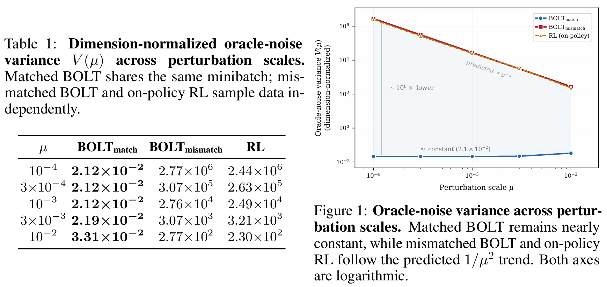
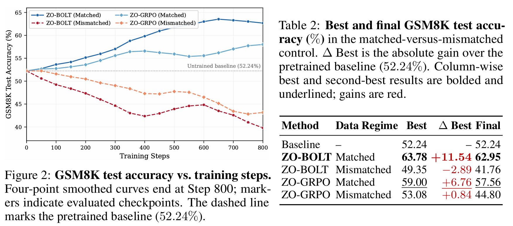

# The Cost of Mismatch: Noise Amplification in Zeroth-Order Reinforcement Learning

Lianmin Chen · Junbin Qiu · Chenxing Wei · Yao Shu · Kun He

Repository for reproducing the paper "The Cost of Mismatch: Noise Amplification in Zeroth-Order Reinforcement Learning".

## Oracle-Noise Variance in Matched vs. Mismatched Regimes

The paper develops a variance-theoretic framework for zeroth-order (ZO) gradient estimation under noisy function evaluations. In the analyzed **mismatched-data** regime of on-policy RL, the oracle-noise term is amplified as $1/\mu^2$ when the perturbation scale $\mu$ decreases. In the **matched-data** regime of BOLT, evaluating both functions on the same minibatch eliminates this amplification through noise cancellation. Controlled perturbation-scale experiments test this separation.

The [`oracle_noise_variance/README.md`](oracle_noise_variance/README.md) explains how to run the matched-versus-mismatched BOLT comparison and the fresh-rollout RL experiment, then combine their results into the paper's variance comparison.

## ZO-BOLT

Motivated by the matched-data analysis, the paper proposes **ZO-BOLT**, which applies ZO optimization to BOLT's RLVR-aligned weighted-SFT objective. Experiments across three model variants and two mathematical-reasoning benchmarks show that ZO-BOLT consistently improves over the pretrained baseline while retaining a near-inference memory footprint. The GSM8K code here provides data generation, a first-order BOLT baseline, matched ZO-BOLT training, and checkpoint evaluation.

The [`ZO-BOLT/gsm8k/README.md`](ZO-BOLT/gsm8k/README.md) provides the commands for generating shared training data, training the BOLT and matched ZO-BOLT models, and evaluating their checkpoints.

## License

Original repository code is available under the [MIT License](LICENSE). The math grader files retain their [Apache License 2.0 notices](THIRD_PARTY_NOTICES.md).
